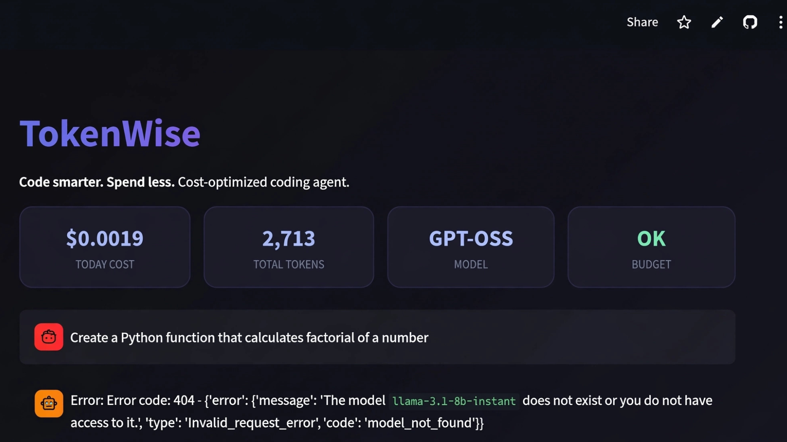
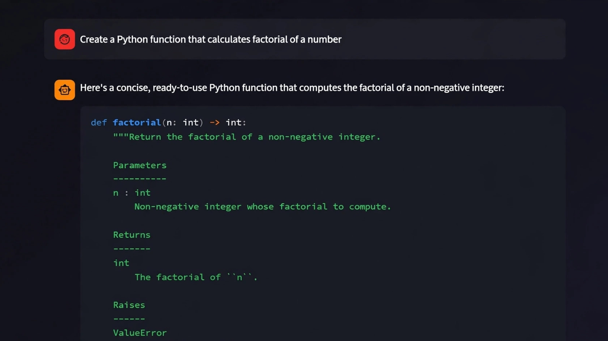
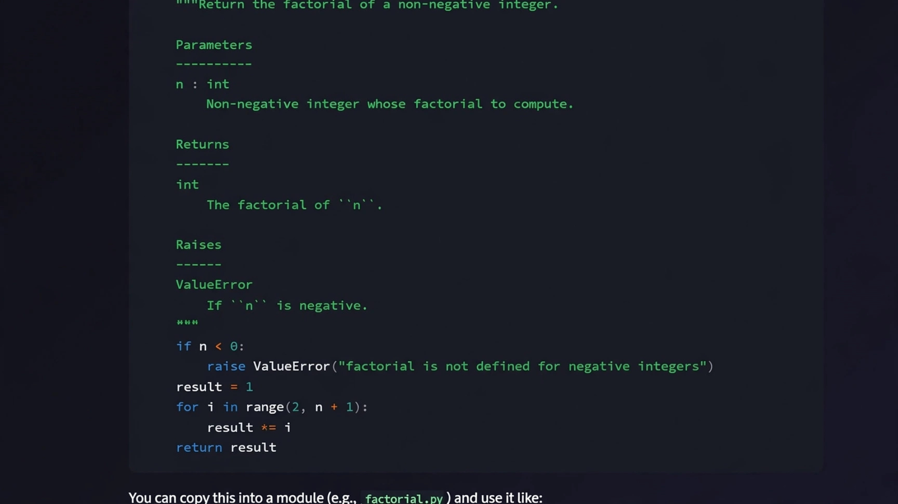
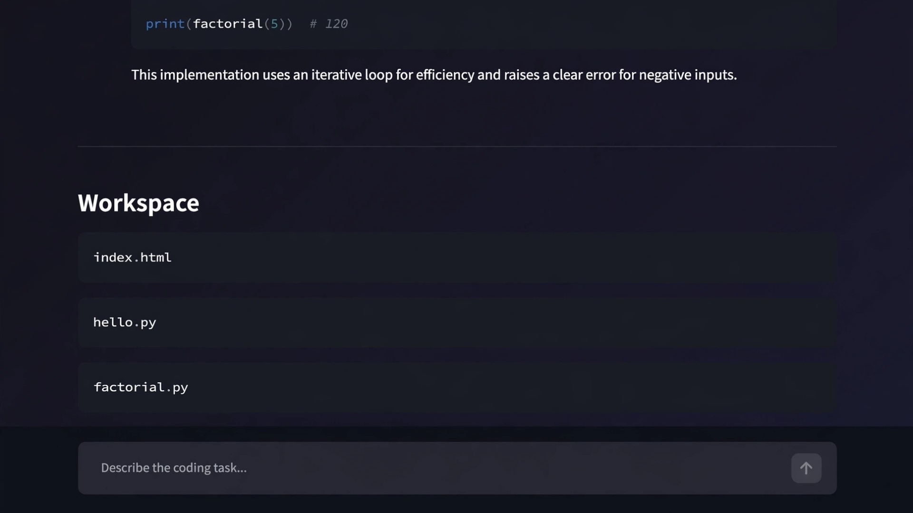

# ⚡ TokenWise

### Code smarter. Spend less.

**TokenWise** is a cost-optimized AI coding agent that completes real development tasks while aggressively minimizing token usage and operational cost.

Built for the **Global AI Hackathon 2026** by Geek Room, with deep integration of **Bifrost AI Gateway**.

<p align="center">
  
  
  
  
</p>

---

## ✨ Key Features

| Feature | Description |
|---------|-------------|
| **Bifrost Gateway** | All LLM calls are routed through Bifrost for automatic failover, unified access, and better reliability |
| **Real-time Cost Tracking** | Every request is monitored for tokens and estimated cost |
| **Daily Budget Control** | Set a spending limit — the agent stops when budget is exceeded |
| **Smart Model Fallback** | Automatically switches models when a provider is down |
| **Local Model Support** | Use Ollama for private/confidential repositories |
| **Human-in-the-loop** | Approval required before risky operations (file writes, deletions) |
| **Sandboxed Workspace** | All file operations happen inside a safe controlled directory |
| **Modern Dark UI** | Clean Streamlit interface with live metrics dashboard |

---

## 🎯 Problem It Solves

Most coding agents are powerful but **expensive and unreliable**. They:

- Burn tokens unnecessarily
- Fail when one provider goes down
- Have no spending control
- Risk writing files without permission

**TokenWise** fixes these problems by combining intelligent agent design with Bifrost Gateway.

---

## 🚀 Quick Start

### 1. Start Bifrost Gateway
```bash
npx -y @maximhq/bifrost
```
Open [http://localhost:8080](http://localhost:8080) and add your Groq / OpenAI API keys.

### 2. Setup TokenWise
```bash
git clone https://github.com/ashutosh9151/TokenWise.git
cd TokenWise

python -m venv venv
source venv/bin/activate          # Windows: venv\Scripts\activate
pip install -r requirements.txt
cp .env.example .env
```

### 3. Configure `.env`
```env
USE_BIFROST=true
BIFROST_BASE_URL=http://localhost:8080
GROQ_API_KEY=gsk_your_key_here
DEFAULT_MODEL=groq/llama-3.3-70b-versatile
MAX_DAILY_BUDGET_USD=2.00
```

### 4. Run
```bash
streamlit run app.py
```

---

## 🛠️ Tech Stack

| Layer | Technology |
|-------|------------|
| Agent Framework | LangGraph + LangChain |
| AI Gateway | **Bifrost** (Maxim AI) |
| LLMs | Groq, OpenAI, Ollama |
| UI | Streamlit |
| Cost Tracking | Custom tracker |
| Safety | Path sandboxing + approval system |

---

## 📁 Project Structure

```
TokenWise/
├── app.py                  # Main Streamlit application
├── agent/
│   └── tokenwise_agent.py  # LangGraph agent + Bifrost support
├── tools/
│   └── file_tools.py       # Safe file system tools
├── utils/
│   ├── config.py           # Settings
│   └── cost_tracker.py     # Token & cost monitoring
├── workspace/              # Sandboxed file system
├── requirements.txt
├── .env.example
└── README.md
```

---

## 🏆 Hackathon Alignment

This project directly addresses the **Cost-Optimized Coding Agent** challenge:

- Minimizes token consumption through focused tool use
- Continues working through provider outages (via Bifrost failover)
- Enforces individual spending limits
- Supports local models for confidential code
- Designed with human approval for risky operations
- Uses official title partner technology (**Bifrost**)

---

## 📸 Screenshots

### Dashboard


### Agent Generating Code



### Workspace with Generated Files


---

## 📄 License

MIT License © 2026 **Ashutosh Prajapati**

---

<div align="center">
  <strong>Built with ❤️ for the Global AI Hackathon 2026</strong><br>
  TokenWise — Code smarter. Spend less.
</div>
